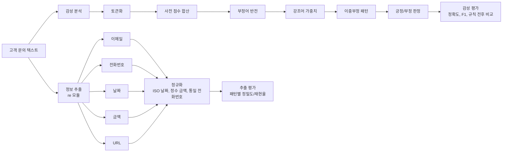
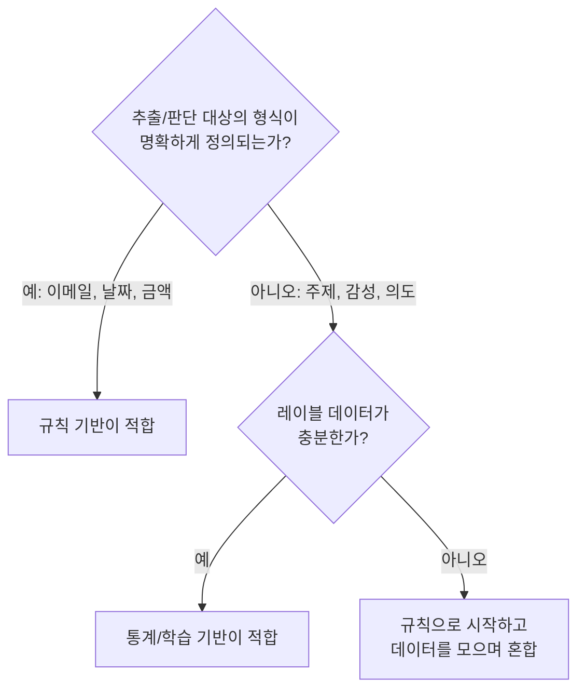

# A4-2 개념 정리 — 정규표현식 정보 추출과 감성 사전 기반 감성 분석

대상: Python 문자열과 리스트는 다룰 수 있지만 정규표현식과 감성 분석은 처음인 학습자<br>
기준 과제: [A4-2 과제 명세](../subject.md)<br>
함께 보는 문서: [단계별 실습 가이드](WALKTHROUGH.md)

이 문서는 정답 패턴이나 완성 코드를 주지 않습니다. **규칙을 직접 설계하려면 무엇을 알아야 하는지**를 설명합니다. 개념마다 일상 비유로 감을 잡고, 정확한 정의를 본 다음, 작은 예제를 손으로 계산해 보고, 과제의 어느 요구사항과 연결되는지 확인합니다.

과제의 핵심 질문은 "**규칙으로 언어를 정의할 수 있는가?**"입니다. 이 문서를 다 읽으면 "형식이 정해진 정보는 규칙이 강하고, 뜻이 문맥에 달린 정보는 규칙이 약하다"를 구체적 사례로 설명할 수 있어야 합니다.

> 표기 주의: 이 문서에서 달러 기호가 들어간 금액(예: `$100`)과 정규식은 모두 코드 표기로 씁니다. GitHub에서 일반 글의 달러 기호는 수식 기호로 해석될 수 있기 때문입니다. README를 쓸 때도 같은 점을 주의합니다.

## 읽는 순서

| 순서 | 배울 내용 | 이걸 알면 할 수 있는 일 |
| --- | --- | --- |
| 1 | 정보 추출, 감성 분석, 규칙 기반 접근 | 과제 전체 파이프라인을 설명하기 |
| 2 | 정규표현식 기본 문법 | 메타문자, 수량자, 그룹, 캡처로 패턴 쓰기 |
| 3 | Python `re` 모듈 사용법 | `finditer`, `compile`, `VERBOSE`로 주석 달린 패턴 쓰기 |
| 4 | 한국어 텍스트에서의 정규식 함정 | 조사가 붙은 이메일, URL을 정확히 끊기 |
| 5 | 다섯 가지 패턴의 구조 | 이메일, 전화번호, 날짜, 금액, URL 패턴 설계하기 |
| 6 | 정규화 | 날짜를 ISO 8601로, 금액을 정수로, 전화번호를 통일 형식으로 |
| 7 | 정보 추출 평가 (정밀도, 재현율) | 패턴별 성능 표 만들기 |
| 8 | 감성 사전 | 200개 이상 사전 구축, 도메인 단어 추가 |
| 9 | 한국어 형태소와 사전 매칭 | 활용형(`맛있었다`)을 사전 단어(`맛있다`)와 맞추기 |
| 10 | 부정어 처리 | "좋지 않다"를 부정으로 판정하기 |
| 11 | 강조어 처리 | "매우 좋다"를 강한 긍정으로 판정하기 |
| 12 | 이중부정 | "좋지 않은 것은 아니다"를 처리하기 |
| 13 | 점수에서 레이블로, 감성 분석 평가 | 정확도, F1, 규칙 전후 비교, 오분류 분석 |
| 14 | 규칙 기반 vs 통계 기반 | A4-1과 비교해 각각 언제 쓰는지 설명하기 |
| 15 | (보너스) 마스킹, 규칙 vs TF-IDF, Aspect | 선택 과제 설계하기 |

1~7은 정보 추출 모듈을, 8~13은 감성 분석 모듈을 만들기 전에 읽습니다. 14는 README의 분석 부분을 쓸 때 읽습니다.

---

## 1. 전체 그림: 규칙으로 정보와 감성을 뽑아내기

### 비유

A4-1의 TF-IDF는 "이 글에 어떤 단어가 많이 나오는가"로 **분위기**를 파악하는 방식이었습니다. 그런데 "이 글에서 전화번호를 뽑아 줘"라는 요청은 분위기가 아니라 **형식**의 문제입니다. 전화번호는 `0`으로 시작하는 숫자 2~3개, 하이픈, 숫자 3~4개, 하이픈, 숫자 4개라는 **모양**이 있습니다. 모양을 찾는 도구가 정규표현식입니다.

감성 분석도 비슷하게 규칙으로 할 수 있습니다. "좋다는 +2, 최악은 -3"이라는 **채점표(감성 사전)** 를 만들고, "'않다'가 붙으면 부호를 뒤집는다" 같은 **채점 규칙**을 더합니다.

### 과제 파이프라인



### 정보 추출이란

정보 추출(Information Extraction)은 **비정형 텍스트**(자유롭게 쓴 글)에서 **구조화된 정보**(필드와 값)를 뽑아내는 일입니다.

```text
입력: "문의: support@company.co.kr, 전화 02-1234-5678, 일시: 2024년 3월 15일"
출력: {"email": ["support@company.co.kr"], "phone": ["02-1234-5678"], "date": ["2024-03-15"]}
```

### 규칙 기반 접근의 장단점

| 구분 | 장점 | 단점 |
| --- | --- | --- |
| 정밀도 | 규칙에 맞으면 거의 확실히 맞음 | — |
| 해석 가능성 | "이 패턴 때문에 뽑혔다"를 정확히 설명 가능 | — |
| 데이터 | 학습 데이터 없이 바로 시작 가능 | — |
| 재현율 | — | 규칙이 예상 못 한 표기(`공일공-...`)는 놓침 |
| 확장성·유지보수 | — | 새 형식마다 규칙 추가, 규칙끼리 충돌 |

과제 목표의 "장점(정밀도, 해석 가능성)과 단점(재현율, 유지보수)"이 이 표입니다. 평가에서 이 장단점이 **숫자로** 드러나는지 확인하는 것이 과제의 큰 흐름입니다.

---

## 2. 정규표현식 기본 문법

### 비유

정규표현식은 "**찾고 싶은 글자의 모양을 설명하는 작은 언어**"입니다. "숫자 3개, 하이픈, 숫자 4개"를 `\d{3}-\d{4}`라고 씁니다.

### 2.1 리터럴과 메타문자

대부분의 글자는 자기 자신과 일치합니다(리터럴). 다음 글자는 특별한 뜻이 있는 **메타문자**라서, 글자 그대로 찾으려면 앞에 `\`를 붙여야 합니다.

```text
.  ^  $  *  +  ?  {  }  [  ]  \  |  (  )
```

예: 이메일의 점은 `\.`, 달러 기호는 `\$`, URL의 물음표는 `\?`로 씁니다. 점을 그냥 `.`으로 쓰면 "아무 글자 하나"가 되어 `gmailXcom`도 일치합니다.

### 2.2 문자 클래스

| 표기 | 뜻 | 예 |
| --- | --- | --- |
| `[abc]` | a, b, c 중 하나 | `[-./]` 하이픈, 점, 슬래시 중 하나 |
| `[0-9]`, `[a-z]` | 범위 | `[0-9A-Fa-f]` 16진수 |
| `[^...]` | 괄호 안 글자를 **제외한** 하나 | `[^\s]` 공백이 아닌 글자 |
| `\d` | 숫자 | |
| `\s` | 공백류(스페이스, 탭, 줄바꿈) | |
| `\w` | 단어 글자 (Python 3에서는 **한글 포함**) | 4장에서 함정으로 다룸 |
| `[가-힣]` | 완성형 한글 한 글자 | |

### 2.3 수량자

| 표기 | 뜻 |
| --- | --- |
| `?` | 0번 또는 1번 (있어도 되고 없어도 됨) |
| `*` | 0번 이상 |
| `+` | 1번 이상 |
| `{n}` | 정확히 n번 |
| `{m,n}` | m번 이상 n번 이하 |

수량자는 기본적으로 **탐욕적(greedy)** 이라 가능한 한 길게 일치합니다. 뒤에 `?`를 붙이면(`*?`, `+?`) 가능한 한 짧게 일치합니다.

```text
텍스트:  <a> 와 <b>
<.*>     → "<a> 와 <b>" 전체 (탐욕적)
<.*?>    → "<a>", "<b>" (게으른)
```

### 2.4 앵커와 경계

| 표기 | 뜻 |
| --- | --- |
| `^`, `$` | 문자열(또는 `re.MULTILINE`에서 줄)의 시작과 끝 |
| `\b` | 단어 경계 (단어 글자와 비단어 글자 사이) |
| `(?<!\d)` | 바로 앞이 숫자가 **아니어야** 함 (부정 후방 탐색) |
| `(?!\d)` | 바로 뒤가 숫자가 **아니어야** 함 (부정 전방 탐색) |

전후방 탐색(lookaround)은 글자를 소비하지 않고 "앞뒤 조건"만 검사합니다. 예를 들어 `(?<!\d)\d{3}-\d{4}(?!\d)`는 `1234-56789` 같은 더 긴 숫자열의 **일부만** 잘라 뽑는 것을 막습니다.

### 2.5 그룹과 캡처

| 표기 | 이름 | 하는 일 |
| --- | --- | --- |
| `( ... )` | 캡처 그룹 | 묶고, 일치한 부분을 번호로 저장 (`m.group(1)`) |
| `(?: ... )` | 비캡처 그룹 | 묶기만 하고 저장하지 않음 |
| `(?P<name> ... )` | 이름 있는 그룹 | 이름으로 꺼냄 (`m.group('year')`) |
| `a\|b` | 대안 | a 또는 b (세로 막대 하나) |

캡처 그룹은 **정규화**에 핵심입니다. 날짜 패턴에서 연, 월, 일을 각각 그룹으로 잡아 두면 일치한 뒤 바로 꺼내 `2024-03-15` 형식으로 다시 조립할 수 있습니다.

```python
m = re.search(r"(?P<year>\d{4})년\s*(?P<month>\d{1,2})월", "2024년 3월 15일")
m.group("year"), m.group("month")    # ('2024', '3')
```

---

## 3. Python `re` 모듈 사용법

### 3.1 주요 함수

| 함수 | 반환 | 용도 |
| --- | --- | --- |
| `re.search(p, s)` | 첫 일치 `Match` 또는 `None` | 있는지 확인 |
| `re.match(p, s)` | **문자열 처음**에서만 일치 확인 | 형식 검사 |
| `re.fullmatch(p, s)` | 문자열 **전체**가 일치해야 함 | 입력 검증 |
| `re.findall(p, s)` | 문자열 리스트 (그룹이 있으면 그룹 튜플 리스트) | 간단한 추출 |
| `re.finditer(p, s)` | `Match` 객체 이터레이터 | 위치와 그룹이 모두 필요한 추출 |
| `re.sub(p, repl, s)` | 치환된 문자열 | 정제, 마스킹 |
| `re.compile(p, flags)` | 패턴 객체 | 같은 패턴 반복 사용 |

### 3.2 가장 흔한 함정: `findall`과 그룹

```python
re.findall(r"\d{3}-\d{4}", "123-4567")         # ['123-4567']
re.findall(r"(\d{3})-(\d{4})", "123-4567")     # [('123', '4567')]  전체가 아니라 그룹만!
```

패턴에 그룹이 하나라도 있으면 `findall`은 **전체 일치가 아니라 그룹 내용**을 돌려줍니다. 추출 모듈에서는 `finditer`를 쓰고 `m.group(0)`(전체)과 이름 있는 그룹을 함께 꺼내는 편이 안전합니다.

### 3.3 raw string

정규식은 항상 `r"..."`(raw string)로 씁니다. 일반 문자열에서 `"\b"`는 백스페이스 문자로 바뀌어 단어 경계가 아니게 됩니다.

### 3.4 플래그

| 플래그 | 효과 | 과제에서 쓰는 곳 |
| --- | --- | --- |
| `re.VERBOSE` (`re.X`) | 패턴 안의 공백 무시, `#` 뒤를 주석으로 처리 | **모든 패턴에 주석** 요구사항 |
| `re.IGNORECASE` (`re.I`) | 대소문자 무시 | 이메일, URL의 도메인 |
| `re.ASCII` (`re.A`) | `\w`, `\d`, `\b`를 ASCII 기준으로 | 한글이 `\w`에 들어가는 문제 회피 |

`re.VERBOSE`를 쓰면 패턴을 여러 줄로 나눠 각 부분에 주석을 달 수 있습니다. 과제 제약 사항 "모든 정규표현식 패턴에 주석으로 의도와 매칭 범위를 설명한다"를 만족시키기 좋은 방법입니다.

```python
EXAMPLE = re.compile(r"""
    (?<!\d)          # 앞이 숫자가 아님 (긴 숫자열 일부 방지)
    \d{3}            # 앞자리 3개
    -                # 구분자
    \d{4}            # 뒷자리 4개
    (?!\d)           # 뒤가 숫자가 아님
""", re.VERBOSE)
```

주의: `VERBOSE`에서는 패턴 안의 **공백이 무시**되므로, 진짜 공백을 찾으려면 `\s`나 `[ ]`로 써야 합니다. `#`도 주석 시작이므로 글자 `#`은 `\#`로 씁니다.

---

## 4. 한국어 텍스트에서의 정규식 함정

한국어 문장에서는 정보 뒤에 **조사가 공백 없이 붙습니다.** 이것이 영어 예제를 그대로 가져오면 실패하는 가장 큰 이유입니다.

### 4.1 `\w`는 한글도 포함한다

Python 3의 `str` 패턴에서 `\w`는 유니코드 단어 글자이므로 한글도 포함합니다.

```text
입력:  이메일은 test.user@sub.domain.co.kr입니다
[\w.]+@[\w.]+  → "test.user@sub.domain.co.kr입니다"   (조사까지 먹음)
```

이메일과 URL에 쓸 수 있는 글자는 `[A-Za-z0-9._%+-]`처럼 **명시적인 ASCII 범위**로 쓰거나 `re.ASCII` 플래그를 씁니다.

### 4.2 `\b`도 한글과 숫자 사이에서는 경계가 아니다

`\b`는 "단어 글자와 비단어 글자 사이"입니다. 한글과 숫자는 둘 다 단어 글자이므로 `전화010-1234-5678`에서 `전화`와 `010` 사이는 경계가 아닙니다. 숫자 패턴의 앞뒤는 `\b` 대신 `(?<!\d)`, `(?!\d)`로 막는 것이 한국어에서 더 안정적입니다.

### 4.3 문장부호와 괄호

- URL 끝의 마침표, 쉼표, 닫는 괄호 `)`나 `>`는 보통 URL의 일부가 아닙니다. 과제 데이터 예시의 `<https://www.example.com/path?q=1>`처럼 꺾쇠로 감싼 경우도 있습니다.
- `(02) 123-4567`처럼 지역번호를 괄호로 감싸는 표기도 흔합니다.

### 4.4 패턴끼리 겹침

| 겹치는 경우 | 예 |
| --- | --- |
| URL 안의 이메일 같은 부분 | `https://site.com/u/user@x.com` |
| 이메일의 도메인이 URL로도 잡힘 | `support@company.co.kr` 안의 `company.co.kr` |
| 날짜와 전화번호 | `2024-03-15`와 `02-123-4567`의 모양 유사 |
| 카드번호의 일부가 전화번호로 | `1234-5678-9012-3456` 안의 `5678-9012` |

같은 위치에 두 패턴이 겹치면 어느 쪽을 우선할지 **규칙으로 정해야** 합니다. 예: 먼저 URL과 이메일을 찾고 그 구간(`m.span()`)을 다른 패턴 검색에서 제외하기. 이런 충돌은 실패 사례 분석의 좋은 재료입니다.

---

## 5. 다섯 가지 패턴의 구조

여기서는 완성 패턴이 아니라 **구조와 변형 목록**을 봅니다. 과제는 패턴마다 **최소 3가지 이상 변형**을 처리하라고 요구합니다.

### 5.1 이메일

```text
local-part  @  domain
user.name   @  sub.domain.co.kr
```

| 부분 | 허용 글자 (실용적 기준) | 주의 |
| --- | --- | --- |
| local-part | 영문, 숫자, `. _ % + -` | 점으로 시작/끝나는 경우 등 엣지 케이스 |
| domain | 점으로 구분된 라벨들 | 마지막 라벨(최상위 도메인)은 영문 2자 이상 |

변형 예: `user@domain.com`, `user.name@sub.domain.co.kr`, `first+tag@mail.io`, 대문자 섞인 주소.

이메일의 공식 규격(RFC 5322)은 매우 복잡해서 완전히 구현하지 않는 것이 보통입니다. "**실제로 자주 쓰이는 형태를 정밀하게**" 잡는 것이 목표이고, 무엇을 지원하지 않는지 주석과 README에 적으면 됩니다.

### 5.2 전화번호

한국 전화번호의 구조는 `국번(지역/이동통신) - 국 - 번호`입니다.

| 종류 | 앞자리 | 가운데 | 끝 | 예 |
| --- | --- | --- | --- | --- |
| 서울 | `02` | 3~4자리 | 4자리 | `02-123-4567`, `02-1234-5678` |
| 기타 지역 | `031`~`064` 등 3자리 | 3~4자리 | 4자리 | `031-1234-5678` |
| 휴대전화 | `010` 등 `01X` | 3~4자리 | 4자리 | `010-1234-5678` |

구분자 변형: 하이픈(`-`), 점(`.`), 공백, 구분자 없음(`01012345678`), 괄호 지역번호(`(02) 123-4567`).

구분자가 없을 때는 앞자리가 `02`인지 아닌지에 따라 자르는 위치가 달라집니다. 이것이 정규화(6장)에서 중요합니다.

### 5.3 날짜

| 변형 | 예 | 그룹으로 잡을 것 |
| --- | --- | --- |
| 한글 표기 | `2024년 1월 15일`, `2024년1월15일` | 연, 월, 일 |
| 슬래시 | `2024/01/15`, `2024/1/5` | 연, 월, 일 |
| 하이픈 | `2024-01-15` | 연, 월, 일 |
| 점 (추가 변형 예) | `2024.01.15` | 연, 월, 일 |

정규식은 `2024-13-45`도 모양만 맞으면 잡습니다. 존재하는 날짜인지는 정규식이 아니라 **추출 후 검증**(`datetime.date(y, m, d)`가 오류 없이 만들어지는지)으로 거르는 것이 깔끔합니다.

### 5.4 금액

| 변형 | 예 | 구조 |
| --- | --- | --- |
| 쉼표 숫자 + 원 | `10,000원` | 1~3자리, (쉼표 + 3자리) 반복, `원` |
| 한글 단위 | `1억 2천만원`, `3만 5천원` | (숫자 + 단위) 반복, `원` |
| 달러 | `$100`, `$1,234.56` | `\$` + 숫자(쉼표/소수점) |
| 숫자 + 만원 (추가 변형 예) | `5만원`, `2,500만원` | 숫자 + 단위 + `원` |

`$`는 메타문자이므로 패턴에서 `\$`로 써야 합니다. 쉼표 패턴 `\d{1,3}(?:,\d{3})+`처럼 비캡처 그룹으로 반복을 묶는 연습을 하기에 좋은 패턴입니다.

### 5.5 URL

```text
https://www.example.com/path?query=value#frag
└─┬──┘  └──────┬──────┘└─┬─┘└─────┬────┘└─┬─┘
 scheme       host      path    query   fragment
```

변형 예: `http://`와 `https://`, `www.`로 시작하고 scheme이 없는 형태, 경로/쿼리 유무, 포트(`:8080`).

URL에 쓸 수 있는 글자는 RFC 3986에 정해져 있습니다. 실용적으로는 "공백, 한글, 꺾쇠, 따옴표가 아닌 글자의 연속"으로 잡고, 끝에 붙은 문장부호(`.`, `,`, `)`)를 떼어 내는 후처리를 하는 방식이 흔합니다.

---

## 6. 정규화

### 비유

같은 사람의 생일을 "2024년 1월 15일", "2024/01/15", "24.1.15"로 적은 서류가 섞여 있으면 정렬도, 비교도 어렵습니다. **한 가지 표준 형식**으로 바꾸는 것이 정규화입니다. 과제는 "추출 결과를 정규화된 형식으로 반환"하라고 요구합니다.

| 패턴 | 정규화 형식 (과제 예시 기준) | 예 |
| --- | --- | --- |
| 날짜 | ISO 8601 `YYYY-MM-DD` | `2024년 1월 15일` → `2024-01-15` |
| 금액 | 정수 | `10,000원` → `10000` |
| 전화번호 | 하이픈 구분 통일 형식 | `01012345678` → `010-1234-5678` |
| 이메일 (권장) | 소문자 | `User@Domain.COM` → `user@domain.com` |
| URL (권장) | 끝 문장부호 제거 | `https://a.com/x).` → `https://a.com/x` |

### 6.1 날짜: ISO 8601

ISO 8601은 날짜를 `연-월-일` 순서로, 월과 일을 **두 자리로 0을 채워** 쓰는 국제 표준입니다. 문자열로 정렬해도 날짜 순서가 맞는 것이 장점입니다. Python에서는 `f"{y:04d}-{m:02d}-{d:02d}"`나 `datetime.date(y, m, d).isoformat()`으로 만듭니다.

### 6.2 금액: 한국어 수 단위 계산

한국어 수는 **네 자리씩** 끊어 읽습니다. 큰 단위(만, 억, 조)와 작은 단위(십, 백, 천)를 구분해야 합니다.

| 큰 단위 | 값 | 작은 단위 | 값 |
| --- | --- | --- | --- |
| 만 | $10^4$ | 십 | $10$ |
| 억 | $10^8$ | 백 | $10^2$ |
| 조 | $10^{12}$ | 천 | $10^3$ |

계산 원리: 큰 단위가 나올 때까지 작은 단위 값을 모아 두었다가, 큰 단위가 나오면 모은 값에 큰 단위를 곱해 총합에 더합니다.

**손 계산 예제 1 — `1억 2천만원`**

1. `1억`: 모은 값 1 → $1 \times 10^8 = 100{,}000{,}000$을 총합에 더함
2. `2천`: 작은 단위 → 모은 값 $2 \times 10^3 = 2{,}000$
3. `만`: 큰 단위 → $2{,}000 \times 10^4 = 20{,}000{,}000$을 총합에 더함
4. 총합 $= 120{,}000{,}000$

**손 계산 예제 2 — `3만 5천원`**

1. `3만` → $3 \times 10^4 = 30{,}000$
2. `5천` → 큰 단위 없이 끝남 → 남은 $5 \times 10^3 = 5{,}000$을 그대로 더함
3. 총합 $= 35{,}000$

**손 계산 예제 3 — `2,500만원`**

쉼표를 지운 `2500`이 모은 값 → `만` → $2500 \times 10^4 = 25{,}000{,}000$

이 예제 세 개를 그대로 테스트 케이스로 쓰면 정규화 함수를 검증할 수 있습니다.

달러 금액은 원화와 단위가 다르므로, 정수 값과 함께 통화(`KRW`/`USD`)를 같이 돌려주는 등 **설계 결정**이 필요합니다. `$1,234.56`처럼 소수점이 있으면 "정수"로 만드는 방식(센트 단위, 반올림 등)도 정하고 README에 적습니다.

### 6.3 전화번호

구분자를 모두 지운 숫자열에서 시작하면 단순해집니다.

| 숫자열 길이와 앞자리 | 자르는 방법 | 결과 |
| --- | --- | --- |
| `02`로 시작, 9자리 | 2 / 3 / 4 | `02-123-4567` |
| `02`로 시작, 10자리 | 2 / 4 / 4 | `02-1234-5678` |
| 그 외, 10자리 | 3 / 3 / 4 | `031-123-4567` |
| 그 외, 11자리 | 3 / 4 / 4 | `010-1234-5678` |

### 흔한 오해

- "정규화는 출력할 때 보기 좋게 하는 것" — 정규화는 **평가의 기준**이기도 합니다. 정답 레이블을 정규화된 값으로 적어 두면, 표기만 다른 추출 결과도 정확히 비교할 수 있습니다.
- "정규식이 잡았으면 값도 맞다" — `2024-02-30`은 정규식은 통과하지만 존재하지 않는 날짜입니다.

---

## 7. 정보 추출 평가: 정밀도와 재현율

### 비유

그물로 물고기를 잡는다고 합시다.

- **정밀도(Precision)**: 그물에 걸린 것 중 진짜 물고기의 비율. 쓰레기가 많이 걸리면 낮아집니다.
- **재현율(Recall)**: 바다에 있던 물고기 중 그물에 걸린 비율. 그물코가 커서 빠져나간 물고기가 많으면 낮아집니다.

규칙 기반은 보통 "그물코를 촘촘하게 잡은 것은 확실한" 쪽이라 정밀도가 높고, 예상 못 한 모양의 물고기를 놓쳐 재현율이 낮아지기 쉽습니다.

### 정의

| 기호 | 뜻 | 추출에서의 의미 |
| --- | --- | --- |
| TP | 참 양성 | 정답에 있고, 추출도 한 값 |
| FP | 거짓 양성 | 정답에 없는데 추출한 값 (잘못 뽑음) |
| FN | 거짓 음성 | 정답에 있는데 추출 못 한 값 (놓침) |

$$\text{Precision} = \frac{TP}{TP + FP}, \qquad \text{Recall} = \frac{TP}{TP + FN}, \qquad F_1 = \frac{2PR}{P + R} = \frac{2\,TP}{2\,TP + FP + FN}$$

### 손 계산 예제

전화번호 테스트 문장 10개에 정답 전화번호가 총 12개 있습니다. 내 추출기는 11개를 뽑았고, 그중 10개가 정답과 일치했습니다.

- TP = 10, FP = 11 − 10 = 1, FN = 12 − 10 = 2
- Precision = $10/11 = 0.909$
- Recall = $10/12 = 0.833$
- F1 = $20/(20 + 1 + 2) = 20/23 = 0.870$

### 평가 데이터 설계

과제 요구: **테스트 문장 50개 이상(패턴별 10문장 이상)**, 패턴별 정밀도와 재현율, **실패 사례 5건 이상을 유형별로 분류**하고 원인 분석.

정답(gold) 데이터는 문장마다 "패턴별로 들어 있어야 할 정규화된 값 목록"으로 적습니다.

```json
{"text": "전화번호는 02-123-4567 또는 031-1234-5678", "phone": ["02-123-4567", "031-1234-5678"]}
```

권장 사항:

- 정답 값이 **없는** 문장(예: `버전 1.2.3 출시`)도 넣어야 FP를 측정할 수 있습니다.
- 한 문장에 같은 값이 두 번 나올 수 있으므로 집합보다 **개수까지 세는 비교**(예: `collections.Counter`)가 정확합니다.
- 정답을 먼저 쓰고, 패턴은 나중에 만듭니다. 패턴을 보고 정답을 쓰면 무의식적으로 "잡히는 것만" 테스트하게 됩니다.

### 실패 유형 분류 예

| 유형 | 예 | 원인 |
| --- | --- | --- |
| 표기 미지원 | `공일공-일이삼사-오육칠팔` | 한글 숫자 |
| 경계 오류 (과다 일치) | `...co.kr입니다` | `\w`가 한글 포함 |
| 경계 오류 (과소 일치) | `1억 2천만원` 중 `2천만원`만 추출 | 단위 반복 미처리 |
| 패턴 충돌 | 카드번호 일부가 전화번호로 | 앞뒤 숫자 검사 없음 |
| 정규화 오류 | `2024/1/5` → `2024-1-5` | 0 채우기 누락 |
| 문맥 필요 | `3월 15일` (연도 없음) | 규칙만으로는 연도를 알 수 없음 |

---

## 8. 감성 사전

### 비유

영화 리뷰를 읽고 별점을 매기는 대신, "좋다 +2, 최고 +3, 별로 -1, 최악 -3" 같은 **단어별 점수표**를 만들어 문장 속 단어 점수를 더하는 방식입니다.

### 정의

감성 사전(sentiment lexicon)은 단어와 그 **극성(polarity, 긍정/부정 방향)** 및 **강도**를 짝지은 목록입니다. 문장 점수의 가장 기본 형태는

$$\text{score}(s) = \sum_{w \in s} \text{lex}(w)$$

이고, 사전에 없는 단어는 0으로 봅니다.

### 사전을 구하는 두 가지 방법

| 방법 | 예 | 과제 조건 |
| --- | --- | --- |
| 공개 사전 활용 | KNU 한국어 감성사전(KnuSentiLex), 영어는 NLTK VADER | **출처 명시** + **도메인 특화 단어 30개 이상 직접 추가** (사전 전체 200개 이상) |
| 직접 구축 | `{'좋다': 2, '최악': -3, ...}` | **최소 200개 이상 단어** (데이터 준비 체크리스트의 도메인 특화 단어 30개 이상도 포함) |

KNU 감성사전은 단어마다 -2~+2의 극성 값을 가진 JSON 파일(`SentiWord_info.json`)을 제공합니다. 파일을 열어 키 이름과 값의 자료형(문자열인지 숫자인지)을 직접 확인한 뒤 Python의 `json` 모듈로 읽는 것이 확실합니다. 과제 참고 예시는 `pd.read_csv`로 읽고 있지만 JSON 파일이므로 그대로는 동작하지 않을 수 있습니다.

### 도메인 특화 단어가 필요한 이유

같은 단어도 분야에 따라 감성이 달라집니다.

| 단어 | 배송 리뷰 | 배터리 리뷰 | 영화 리뷰 |
| --- | --- | --- | --- |
| 빠르다 | 긍정 | 부정 ("빨리 닳는다") | 중립 |
| 길다 | 부정 (대기) | 긍정 (사용 시간) | 부정 (지루함) 또는 중립 |
| 소름 | — | — | 긍정 ("소름 돋는 연기") |

영화 리뷰(NSMC)를 쓴다면 `꿀잼`, `노잼`, `명작`, `졸작`, `연기력`, `발연기`, `시간낭비` 같은 단어가 일반 사전에는 없거나 점수가 맞지 않습니다. 과제는 이런 단어를 **최소 30개 이상 직접 추가**하라고 합니다. 데이터에서 자주 나오지만 사전에 없는 단어를 빈도순으로 뽑아 보면 후보를 찾기 쉽습니다.

### 흔한 오해

- "사전이 클수록 좋다" — 도메인과 맞지 않는 단어가 많으면 오히려 잡음이 됩니다.
- "강조어와 부정어도 감성 사전에 숫자로 넣는다" — 과제 참고 예시처럼 한 딕셔너리에 섞어 둘 수는 있지만, 계산에서는 **역할이 다릅니다**. 감성어는 더하고, 강조어는 곱하고, 부정어는 부호를 뒤집습니다. 별도 목록으로 관리하면 실수가 줄어듭니다(권장).

---

## 9. 한국어 형태소와 사전 매칭

### 문제

사전에 `맛있다: +2`가 있어도, 실제 문장에는 `맛있어요`, `맛있었는데`, `맛있지`처럼 **활용형**으로 나옵니다. 문자열이 정확히 같지 않으면 사전에서 찾을 수 없습니다.

### 형태소 분석으로 해결하기

한국어 용언(동사, 형용사)은 **어간 + 어미**로 이루어집니다.

```text
맛있었는데 = 맛있(어간) + 었(과거) + 는데(연결 어미)
좋지      = 좋(어간) + 지(어미)
```

| 방법 | 결과 예 | 장단점 |
| --- | --- | --- |
| KoNLPy `Okt.pos(text, stem=True)` | `맛있었는데` → `맛있다` (원형 복원) | 사전 원형과 매칭 쉬움 |
| `Komoran`, `Mecab` 등 형태소 단위 | `맛있`, `었`, `는데` | 사전을 어간 형태로 만들어야 함 |
| 공백 토큰 + 접두 매칭 (권장 대안) | `맛있었는데`가 `맛있`으로 시작 | 설치 불필요, 오탐 가능 |

과제 결과 예시의 토큰 `[이, 식당, 은, 정말, 맛있, 지, 않았어요]`는 어간 단위로 나눈 예입니다. 분석기마다 결과가 다르므로 **사용할 분석기로 직접 출력해 보고**, 사전의 단어 형태(원형 `좋다`인지 어간 `좋`인지)를 그에 맞춥니다. KoNLPy는 Java(JDK)가 필요합니다.

과제 제약 사항은 "형태소 분석: KoNLPy(한국어) 또는 NLTK(영어) 사용 가능"이므로, 형태소 분석기는 선택입니다. 다만 최소 요구에 **토큰화**가 들어 있으므로 어떤 방식이든 토큰화 단계는 있어야 합니다.

---

## 10. 부정어 처리

### 비유

"맛있다"에 "안"이나 "않다"가 붙으면 저울의 방향이 반대로 기웁니다.

### 한국어 부정 표현의 종류

| 종류 | 형태 | 위치 | 예 |
| --- | --- | --- | --- |
| 짧은 부정 | `안`, `못` + 용언 | 감성어 **앞** | 안 좋다, 못 먹겠다 |
| 긴 부정 | 용언 + `-지 않다`, `-지 못하다` | 감성어 **뒤** | 좋지 않다, 맛있지 않았어요 |
| 서술 부정 | `아니다` | 뒤 | 좋은 건 아니다 |
| 존재 부정 | `없다` | 뒤 | 재미가 없다 |

영어(`not good`)는 부정어가 대부분 앞에 오지만, 한국어는 **앞에도 뒤에도** 올 수 있습니다. 그래서 부정어 탐지 **범위(scope)** 를 감성어 기준으로 앞뒤 몇 토큰까지 볼지 설계해야 합니다.

### 규칙

$$\text{score}(w) = \text{lex}(w) \times (-1)^{k}$$

$k$는 감성어 $w$의 범위 안에 있는 부정어 개수입니다. $k = 1$이면 부호가 뒤집힙니다.

### 손 계산 예제

| 문장 | 감성어 | 부정어 | 계산 | 결과 |
| --- | --- | --- | --- | --- |
| 맛있어요 | 맛있다(+2) | 없음 | $+2$ | 긍정 |
| 맛있지 않아요 | 맛있다(+2) | 않다 | $+2 \times (-1) = -2$ | 부정 |
| 나쁘지 않아요 | 나쁘다(-2) | 않다 | $-2 \times (-1) = +2$ | 긍정 |

세 번째 줄은 생각해 볼 점이 있습니다. "나쁘지 않다"는 실제로는 "**꽤 괜찮다**" 정도의 약한 긍정입니다. 부정 시 부호만 뒤집지 않고 크기를 줄이는 방식(예: $\times (-0.5)$)도 설계할 수 있습니다. 어느 쪽을 택하든 근거와 효과를 평가로 보여 주면 됩니다.

### 흔한 오해와 함정

- **`없다`의 이중 역할**: `재미없다`는 한 단어로 부정 감성어이고, `재미가 없다`는 `재미`(긍정) + 부정어 `없다`입니다. 띄어쓰기에 따라 처리 경로가 달라지므로, 사전에 `재미없다`를 직접 넣을지, 토큰화 결과를 어떻게 다룰지 확인해야 합니다.
- **`문제없다`, `걱정 없다`**: 부정 감성어(`문제`, `걱정`) + `없다` = 긍정입니다. 부정어 규칙이 제대로 동작하면 자연스럽게 처리됩니다.
- **범위가 너무 넓으면**: "좋았는데 배송은 안 왔다"에서 `안`이 `좋다`까지 뒤집으면 오판입니다. 쉼표, 연결 어미(`-는데`, `-지만`)를 범위의 경계로 삼는 방법이 있습니다(권장).

---

## 11. 강조어 처리

### 비유

"좋다"와 "정말 좋다"는 같은 방향이지만 **볼륨**이 다릅니다. 강조어는 볼륨 다이얼입니다.

### 규칙

$$\text{score}(w) = \text{lex}(w) \times \alpha$$

$\alpha$는 강조어 가중치입니다. 과제 참고 예시는 `매우`, `정말`, `너무`에 1.5를 씁니다. `조금`, `약간`, `좀` 같은 **완화어**에 1보다 작은 가중치(예: 0.5)를 주는 것도 같은 원리입니다(권장).

### 손 계산 예제 (과제 결과 예시)

문장: "이 식당은 정말 맛있지 않았어요"

1. 감성어: `맛있`(+2)
2. 부정어: `않았어요` → $\times (-1)$
3. 강조어: `정말` → $\times 1.5$
4. 계산: $(+2) \times (-1) \times 1.5 = -3$ → 부정

곱셈은 순서를 바꿔도 결과가 같으므로, 부정과 강조를 어떤 순서로 적용하든 이 경우에는 같은 값이 나옵니다. 다만 "정말"이 부정 전체를 꾸미는지("정말 안 좋다" = 매우 나쁨) 감성어만 꾸미는지("정말 좋지는 않다" = 그다지 좋지 않음)는 의미가 다를 수 있어, 이런 문장이 오분류 분석 재료가 됩니다.

### 흔한 오해

- "`너무`는 항상 강조어" — 대부분 그렇지만 `너무하다`(부정 감성어)처럼 다른 단어의 일부일 수 있습니다.
- "강조어가 여러 개면 계속 곱한다" — `정말 너무 매우 좋다`에서 $1.5^3 = 3.375$배가 됩니다. 상한을 둘지 설계할 수 있습니다.

---

## 12. 이중부정

### 정의

부정이 두 번 겹치면 원래 방향으로 돌아옵니다. 10장의 식에서 $k = 2$이면 $(-1)^2 = +1$입니다.

| 문장 | 감성어 | 부정 횟수 | 결과 |
| --- | --- | --- | --- |
| 좋지 않은 것은 아니다 | 좋다(+2) | 2 (`않`, `아니다`) | $+2$ → 긍정 |
| 맛없지 않은 건 아니다 | 맛없다(-2) | 2 | $-2$ → 부정 |

### 과제의 범위

과제는 최소 요구로 "**이중부정 단일 패턴 처리**"를 명시합니다. 모든 이중부정을 처리할 필요는 없고, **한 가지 패턴을 정해** 정확히 처리하면 됩니다. 예를 들면 원문 문자열에서 `지 않은 (것|건)은? 아니다` 같은 정규식으로 찾는 패턴을 하나 정하고, 그 패턴이 나오면 부정 횟수를 2로 세는 식입니다. 어떤 패턴을 골랐는지, 그 패턴으로 처리되는/안 되는 예를 README에 적습니다.

반어("참 잘~했다"), 비꼼, 복합 감성(Aspect), 문맥 의존 표현은 과제가 **도전 범위(보너스)** 로 분류한 것이므로 필수 구현 대상이 아닙니다. 다만 오분류 분석에서 "이런 사례는 규칙의 한계"로 다루면 좋습니다.

---

## 13. 점수에서 레이블로, 감성 분석 평가

### 13.1 점수를 레이블로 바꾸기

$$\text{label}(s) = \begin{cases} \text{긍정} & \text{score}(s) > \theta \\ \text{부정} & \text{score}(s) \le \theta \end{cases}$$

기본은 $\theta = 0$이지만, 사전 단어가 하나도 없어 **점수가 정확히 0인 문장**을 어떻게 처리할지 정해야 합니다. NSMC처럼 긍정/부정 두 레이블만 있는 데이터라면 0점 문장도 둘 중 하나로 판정해야 하므로, 그 규칙과 0점 문장의 비율(사전 커버리지)을 README에 적습니다. 문장 길이에 따른 점수 차이를 줄이려고 감성어 개수로 나누는 정규화도 선택지입니다(권장).

### 13.2 정확도와 F1

과제 요구: **레이블 데이터 100개 이상**으로 정확도와 F1을 산출합니다.

**손 계산 예제**: 리뷰 100개(긍정 50, 부정 50)

| 실제 \ 예측 | 긍정 | 부정 |
| --- | --- | --- |
| 긍정 | 40 | 10 |
| 부정 | 15 | 35 |

- 정확도 $= (40 + 35)/100 = 0.75$
- 긍정 기준: $P = 40/55 = 0.727$, $R = 40/50 = 0.800$, $F_1 = 80/105 = 0.762$
- 부정 기준: $P = 35/45 = 0.778$, $R = 35/50 = 0.700$, $F_1 = 70/95 = 0.737$
- Macro F1 $= (0.762 + 0.737)/2 = 0.749$

어느 클래스 기준 F1인지, macro인지 README에 밝힙니다. 지표는 직접 계산해도 되고 `sklearn.metrics`를 써도 됩니다(과제가 지표 계산 도구를 제한하지 않음).

### 13.3 규칙 적용 전후 비교 (Ablation)

과제 요구: **부정어/강조어 규칙 적용 전후 성능 비교**. 규칙을 하나씩 켜고 끄며 같은 데이터로 평가합니다.

| 설정 | 사전 합산 | 부정어 | 강조어 | 이중부정 | 정확도 | F1 |
| --- | --- | --- | --- | --- | --- | --- |
| A (기본) | O | X | X | X | | |
| B | O | O | X | X | | |
| C | O | X | O | X | | |
| D (전체) | O | O | O | O | | |

이렇게 하려면 감성 함수가 `use_negation=True`, `use_intensifier=True` 같은 **스위치 인자**를 받도록 설계하는 것이 편합니다(권장). 규칙을 넣었는데 성능이 거의 안 변하거나 오히려 떨어질 수도 있습니다. 그것도 정직하게 보고하고 "해당 규칙이 적용된 문장이 데이터에 몇 개 있었는가"로 원인을 설명하면 좋은 분석이 됩니다.

### 13.4 오분류 분석

과제 요구: **오분류 사례 10건 이상** 수집과 원인 분석. 유형 예시:

| 유형 | 예 | 규칙 기반의 어떤 한계인가 |
| --- | --- | --- |
| 사전 미등록어 | "개꿀잼", 신조어, 오타 | 확장성 |
| 복합 감성 | "가격 대비 품질은 괜찮은데 배송이 너무 느려요" | 단일 점수로 표현 불가 |
| 반어·비꼼 | "참 잘~ 만들었네요 ^^" | 표면 단어와 의도가 반대 |
| 부정 범위 오류 | "좋았는데 다시는 안 갈래요" | 범위 설계 |
| 도메인 극성 | "배터리가 빨리 닳아요"의 `빠르다` | 도메인 의존 |
| 감성어 없음 | "평점 조절용", "10자 채우기" | 커버리지 |
| 레이블 잡음 | 내용과 레이블이 반대인 리뷰 | 데이터 품질 |

---

## 14. 규칙 기반 vs 통계 기반

과제 목표 중 하나는 A4-1(통계 기반)과 A4-2(규칙 기반)의 차이와 적합한 상황을 비교하는 것입니다.

| 관점 | 규칙 기반 (A4-2) | 통계 기반 (A4-1 TF-IDF + 분류기) |
| --- | --- | --- |
| 필요한 것 | 사람이 만든 패턴, 사전 | 레이블이 달린 데이터 |
| 강한 작업 | 형식이 정해진 정보(이메일, 날짜) 추출 | 주제 분류, 유사 문서 검색 |
| 정밀도 / 재현율 경향 | 정밀도 높음, 재현율 낮기 쉬움 | 데이터에 따라 균형 |
| 설명 가능성 | 매우 높음 (어떤 규칙인지 바로 보임) | 가중치로 일부 설명 가능 |
| 새 표현 대응 | 규칙을 사람이 추가 | 데이터를 더 모아 재학습 |
| 데이터가 적을 때 | 유리 | 불리 |
| 유지보수 | 규칙이 늘수록 충돌, 관리 어려움 | 재학습 파이프라인 필요 |



실무에서는 둘을 섞는 경우가 많습니다. 예를 들어 연락처는 정규식으로 뽑고, 문의의 감성은 학습 모델로 판단하는 식입니다.

---

## 15. (보너스) 개념

### 15.1 개인정보 마스킹

추출한 구간(`m.span()`)이나 그룹을 이용해 일부를 `*`로 바꿉니다. `re.sub`의 치환 인자에 **함수**를 넘기면 일치마다 원하는 방식으로 바꿀 수 있습니다.

```text
010-1234-5678        → 010-****-5678
주민등록번호 6-7자리   → 앞 6자리와 뒤 첫 자리만 남기는 식
카드번호 4-4-4-4      → 마지막 4자리만 남기는 식
```

마스킹 테스트에는 **실존하지 않는 가짜 번호**만 씁니다.

### 15.2 규칙 vs 통계 비교 실험

A4-1의 TF-IDF + 분류기를 같은 감성 데이터에 적용하고, 학습 데이터 양을 10개, 100개, 1000개로 바꿔 가며 성능을 비교합니다. 규칙 기반은 학습 데이터 양과 무관하게 성능이 일정하고, 통계 기반은 데이터가 늘수록 좋아지는 경향이 있는지 확인하는 실험입니다. 테스트 세트는 모든 조건에서 같게 고정합니다.

### 15.3 Aspect-based 감성 분석

"음식은 맛있는데 가격이 비싸요" → 음식(긍정), 가격(부정). 측면(aspect) 단어 목록(`음식`, `맛`, `가격`, `서비스`, `배송`)을 정하고, 문장을 연결 어미(`-는데`, `-지만`)나 쉼표로 나눈 뒤 각 조각에서 측면어와 감성어를 짝짓는 규칙으로 시작할 수 있습니다.

---

## 복습 질문

<details>
<summary>1. 패턴 r"(\d{3})-(\d{4})"로 re.findall을 쓰면 무엇이 반환되나요?</summary>

전체 일치 문자열이 아니라 그룹 내용 튜플의 리스트(예: `[('123', '4567')]`)가 반환됩니다. 전체가 필요하면 `finditer`와 `m.group(0)`을 쓰거나 그룹을 비캡처 `(?:...)`로 바꿉니다.
</details>

<details>
<summary>2. "test.user@sub.domain.co.kr입니다"에서 이메일 패턴이 "입니다"까지 잡는 이유와 해결책은?</summary>

Python 3에서 `\w`가 한글을 포함하기 때문입니다. 허용 글자를 `[A-Za-z0-9._%+-]`처럼 명시하거나 `re.ASCII` 플래그를 씁니다.
</details>

<details>
<summary>3. "2억 3천5백만원"을 정수로 정규화하면?</summary>

$2 \times 10^8 + (3 \times 10^3 + 5 \times 10^2) \times 10^4 = 200{,}000{,}000 + 35{,}000{,}000 = 235{,}000{,}000$
</details>

<details>
<summary>4. 정답 이메일 20개, 추출 18개, 그중 정답 17개일 때 정밀도와 재현율은?</summary>

TP 17, FP 1, FN 3. 정밀도 $17/18 = 0.944$, 재현율 $17/20 = 0.85$.
</details>

<details>
<summary>5. 규칙 기반 추출이 보통 재현율보다 정밀도가 높은 이유는?</summary>

규칙에 정확히 맞는 것만 뽑으므로 뽑은 것은 대부분 맞지만(정밀도 높음), 규칙이 예상하지 못한 표기는 아예 뽑지 못하기(재현율 낮음) 때문입니다.
</details>

<details>
<summary>6. "정말 나쁘지 않다"의 점수를 나쁘다(-2), 강조 ×1.5, 부정 ×(-1)로 계산하면? 이 결과는 직관과 맞나요?</summary>

$(-2) \times (-1) \times 1.5 = +3$, 강한 긍정이 됩니다. 실제 의미는 "꽤 괜찮다" 정도의 약한 긍정이라 과하게 계산됩니다. 부정 시 크기를 줄이는 규칙이나 강조어 적용 범위를 조정하는 개선 아이디어로 이어질 수 있습니다.
</details>

<details>
<summary>7. 감성 사전 매칭에 형태소 분석이 도움이 되는 이유는?</summary>

한국어 용언은 `맛있었는데`, `맛있지`처럼 어미가 바뀌어 나타나므로 사전 단어와 문자열이 일치하지 않습니다. 형태소 분석으로 어간이나 원형을 얻으면 사전과 매칭할 수 있습니다.
</details>

<details>
<summary>8. 부정어/강조어 규칙의 효과를 보이려면 어떻게 실험해야 하나요?</summary>

같은 데이터에서 규칙을 끈 상태(사전 합산만)와 켠 상태를 각각 평가해 정확도와 F1을 표로 비교합니다. 규칙을 하나씩 추가한 설정도 함께 보면 각 규칙의 기여를 구분할 수 있습니다.
</details>

<details>
<summary>9. "가격 대비 품질은 괜찮은데 배송이 너무 느려요"가 규칙 기반 감성 분석에서 어려운 이유는?</summary>

긍정(품질)과 부정(배송)이 한 문장에 섞인 복합 감성이라 단일 점수로는 표현할 수 없습니다. 측면별로 나눠 보는 Aspect-based 분석이 필요합니다.
</details>

<details>
<summary>10. 이메일 추출에는 규칙 기반, 뉴스 주제 분류에는 통계 기반이 적합한 이유는?</summary>

이메일은 형식이 명확해 규칙으로 정밀하게 정의할 수 있습니다. 뉴스 주제는 정해진 형식이 없고 다양한 단어의 조합으로 드러나므로, 레이블 데이터에서 패턴을 학습하는 통계 기반이 적합합니다.
</details>

---

## 참고 자료

- [Python — re 모듈](https://docs.python.org/3/library/re.html)
- [Python — Regular Expression HOWTO](https://docs.python.org/3/howto/regex.html)
- [Python — datetime 모듈](https://docs.python.org/3/library/datetime.html)
- [Python — json 모듈](https://docs.python.org/3/library/json.html)
- [Python — collections.Counter](https://docs.python.org/3/library/collections.html#collections.Counter)
- [Python — argparse 모듈](https://docs.python.org/3/library/argparse.html)
- [KoNLPy 공식 문서](https://konlpy.org/en/latest/)
- [NLTK 공식 사이트](https://www.nltk.org/) · [NLTK Data 설치 안내](https://www.nltk.org/data.html)
- [KNU 한국어 감성사전 (KnuSentiLex) 저장소](https://github.com/park1200656/KnuSentiLex)
- [NSMC 데이터셋 저장소](https://github.com/e9t/nsmc)
- [scikit-learn — Metrics and scoring](https://scikit-learn.org/stable/modules/model_evaluation.html)
- [RFC 3986 — URI Generic Syntax](https://www.rfc-editor.org/rfc/rfc3986)
- [RFC 5322 — Internet Message Format (이메일 주소 형식)](https://www.rfc-editor.org/rfc/rfc5322)
- [ISO — ISO 8601 Date and time format](https://www.iso.org/iso-8601-date-and-time-format.html)
