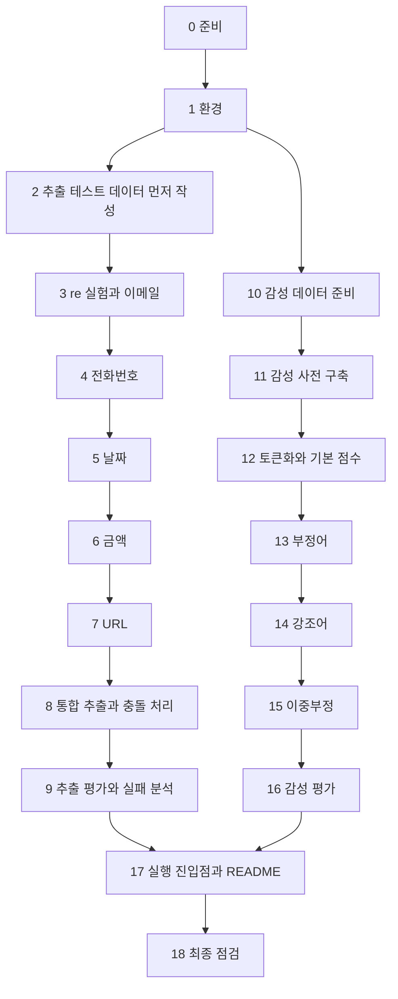

# A4-2 단계별 실습 가이드 — 정규식 정보 추출기와 감성 사전 분석기 만들기

기준 과제: [A4-2 과제 명세](../subject.md)<br>
개념 설명: [개념 정리](LEARNING_GUIDE.md)

이 문서는 환경 설정부터 제출까지 **무엇을 어떤 순서로 만들고, 다음 단계로 넘어가기 전에 무엇을 확인할지** 안내합니다. 완성된 정규식이나 완성 코드는 없습니다. 코드 조각은 함수 모양과 API 사용법을 보여 주는 용도이며, 실제 규칙은 직접 설계해야 합니다.

각 단계는 **목표 / 할 일 / 힌트 / 확인 방법** 순서입니다. 확인 방법(체크포인트)을 통과한 뒤 다음 단계로 넘어갑니다.

> 표기 주의: 달러 금액(`$100`)과 정규식은 README에서도 코드 표기(백틱)로 씁니다. GitHub는 일반 글의 달러 기호를 수식으로 해석할 수 있습니다.

## 전체 흐름



정보 추출(2~9단계)과 감성 분석(10~16단계)은 서로 독립적이므로 어느 쪽을 먼저 해도 됩니다.

## 0단계. 시작 전에 정할 것

**목표:** 과제 요구사항을 체크리스트로 만들고, 파일 구조를 정합니다.

**할 일**

1. [과제 명세](../subject.md)의 4장(기능 요구 사항)과 7장(제약 사항)을 18단계의 자기 점검표 형식으로 옮겨 적습니다.
2. 감성 분석 언어와 데이터를 정합니다. 한국어라면 NSMC + KNU 감성사전(또는 직접 구축), 영어라면 NLTK VADER 사전도 선택지입니다.
3. 파일 구조를 정합니다. 과제는 파일 이름을 정하지 않으므로 아래는 **권장** 구조입니다.

```text
A4-2/
├── README.md               # 설치/실행 방법, 평가, 성공/실패 사례 분석
├── requirements.txt        # 또는 environment.yml (필수)
├── main.py                 # 예: python main.py --text '테스트 문장'
├── extractor.py            # 정규식 패턴(주석 포함) + 추출 + 정규화
├── sentiment.py            # 감성 사전 로드, 점수 계산, 부정어/강조어 규칙
├── evaluate_extraction.py  # 패턴별 정밀도/재현율
├── evaluate_sentiment.py   # 정확도/F1, 규칙 전후 비교, 오분류 수집
├── data/
│   ├── extraction_test.jsonl   # 직접 작성한 테스트 문장 + 정답
│   ├── sentiment_eval.csv      # 레이블 데이터 100개 이상
│   └── lexicon_domain.json     # 직접 추가한 도메인 단어 30개 이상
└── outputs/                    # 평가 결과 표, 오분류 목록
```

**확인 방법:** 각 요구사항이 어느 파일에서 처리될지 말할 수 있습니다.

---

## 1단계. 개발 환경

**목표:** Python 3.10 이상 가상환경과 의존성 파일을 준비합니다.

**할 일**

```bash
python3 --version
python3 -m venv .venv
source .venv/bin/activate        # Windows: .venv\Scripts\activate
pip install pandas               # 데이터 로드용 (권장)
pip install konlpy               # 한국어 형태소 분석을 쓸 때
pip freeze > requirements.txt
```

**힌트**

- 정규식은 **Python 내장 `re` 모듈**만 씁니다. 서드파티 `regex` 패키지는 쓰지 않습니다.
- 형태소 분석은 KoNLPy(한국어) 또는 NLTK(영어)를 쓸 수 있습니다. KoNLPy는 Java(JDK)가 필요합니다. 설치가 막히면 공백 토큰화 + 어간 접두 매칭 같은 대안을 쓰고, 그 선택을 README에 적습니다.
- 영어 VADER를 쓴다면 `nltk.download('vader_lexicon')`이 필요합니다.
- `requirements.txt` 대신 `environment.yml`도 허용됩니다. 둘 중 하나는 반드시 있어야 합니다.

**확인 방법:** 새 가상환경에서 `pip install -r requirements.txt` 후 `python -c "import re, json; print('ok')"`(그리고 쓰는 라이브러리 import)가 성공합니다.

---

## 2단계. 정보 추출 테스트 데이터 먼저 만들기

**목표:** 패턴을 만들기 **전에** 테스트 문장과 정답을 작성합니다.

**할 일**

- 패턴별 **10문장 이상**, 전체 **50문장 이상**을 씁니다.
- 패턴마다 **3가지 이상 변형**이 들어가게 합니다. 과제 4장의 예시 변형(이메일 2종, 전화 3종, 날짜 3종, 금액 3종, URL)을 기본으로 하고 나머지는 직접 추가합니다.
- 각 문장에 **정규화된 정답 값**을 적습니다.

```json
{"id": 12, "text": "기한: 2024/03/15, 2024-03-15", "date": ["2024-03-15", "2024-03-15"]}
```

**힌트**

- 정답이 **없는** 문장, 헷갈리게 만드는 문장(버전 번호 `1.2.3`, 카드번호 모양, 조사가 붙은 이메일)을 섞어야 FP와 실패 사례가 드러납니다.
- 한 문장에 여러 패턴이 섞인 실무형 문장도 몇 개 넣습니다(과제 결과 예시의 고객 문의 문장 참고).
- 개인정보 원칙에 따라 실존 연락처 대신 `example.com` 같은 예시 도메인과 가짜 번호를 씁니다(권장).
- JSON Lines(한 줄에 JSON 하나) 형식이면 한 줄씩 읽고 추가하기 쉽습니다(권장).

**확인 방법**

- 패턴별 문장 수를 세는 짧은 스크립트로 `email 10+, phone 10+, date 10+, money 10+, url 10+, 전체 50+`를 확인합니다.
- 패턴별로 어떤 변형 3가지 이상을 넣었는지 표로 정리할 수 있습니다(README "데이터 구성"에 그대로 사용).

---

## 3단계. `re` 실험과 이메일 추출

**목표:** `re` 사용법을 익히고, 첫 패턴(이메일)을 주석과 함께 완성합니다.

**할 일**

```python
EMAIL_PATTERN = re.compile(r"""
    # TODO: local-part  (의도와 매칭 범위를 주석으로)
    @
    # TODO: domain      (점으로 구분된 라벨, 최상위 도메인)
""", re.VERBOSE | re.IGNORECASE)

def extract_emails(text: str) -> list[str]:
    # TODO: finditer로 찾고, 정규화(예: 소문자)해서 반환
    pass
```

**힌트**

- 먼저 Python 대화형 셸에서 `re.findall`, `re.finditer`, `m.group()`, `m.span()`을 작은 문자열로 실험해 봅니다.
- `\w` 대신 `[A-Za-z0-9._%+-]`처럼 허용 글자를 명시해야 `...co.kr입니다`에서 조사를 먹지 않습니다([개념 정리 4장](LEARNING_GUIDE.md#4-한국어-텍스트에서의-정규식-함정)).
- `VERBOSE` 모드에서는 공백이 무시되고 `#`이 주석입니다.
- 그룹을 쓴다면 `findall`이 그룹만 돌려준다는 점을 기억합니다.

**확인 방법**

- 이메일 테스트 문장 10개 이상에 대해 추출 결과와 정답을 나란히 출력해 눈으로 비교합니다.
- `test.user@sub.domain.co.kr입니다`에서 `test.user@sub.domain.co.kr`만 나옵니다.

---

## 4단계. 전화번호 추출과 정규화

**목표:** 서울(`02`), 지역(`0XX`), 휴대전화(`01X`) 번호를 여러 구분자 변형으로 잡고, 하이픈 통일 형식으로 정규화합니다.

**할 일**

```python
def normalize_phone(raw: str) -> str | None:
    # TODO: 숫자만 남기기 → 길이와 앞자리(02 여부)로 자르는 위치 결정 → 하이픈 조립
    pass
```

**힌트**

- 숫자 패턴의 앞뒤를 `(?<!\d)`, `(?!\d)`로 막아 긴 숫자열(카드번호 등)의 일부를 잡지 않게 합니다.
- 구분자를 `[-.\s]?`처럼 선택적으로 두면 하이픈/점/공백/없음 변형을 한 패턴으로 다룰 수 있습니다. 대신 너무 느슨하면 FP가 늘어납니다.
- 자르는 규칙은 [개념 정리 6.3의 표](LEARNING_GUIDE.md#63-전화번호)를 참고합니다.
- 규칙에 맞지 않는 길이면 `None`을 돌려주고 추출 결과에서 빼는 식으로 설계할 수 있습니다.

**확인 방법**

- `010-1234-5678`, `02-123-4567`, `031-1234-5678`, `01012345678`(구분자 없음) 같은 입력이 모두 하이픈 형식으로 나옵니다.
- `1234-5678-9012-3456`(카드번호 모양)에서 전화번호가 잘못 추출되지 않습니다. 추출된다면 실패 사례 후보로 기록합니다.

---

## 5단계. 날짜 추출과 ISO 8601 정규화

**목표:** `2024년 1월 15일`, `2024/01/15`, `2024-01-15` 등 변형을 잡아 `YYYY-MM-DD`로 반환합니다.

**할 일**

- 연/월/일을 **이름 있는 그룹**(`(?P<year>...)`)으로 잡습니다.
- 추출 후 `datetime.date(y, m, d)`로 실제 존재하는 날짜인지 검증합니다.
- 변형별로 패턴을 나눌지, 하나의 패턴에 대안(`|`)으로 넣을지 정합니다.

**힌트**

- 한글 표기는 `년`, `월`, `일` 사이 공백이 있을 수도 없을 수도 있습니다(`\s*`).
- `2024/1/5`처럼 한 자리 월/일도 `01`, `05`로 0을 채웁니다.
- 날짜 패턴 `\d{4}-\d{2}-\d{2}`가 전화번호와 겹치지 않는지, 반대로 전화번호 패턴이 날짜를 잡지 않는지 확인합니다.
- `3월 15일`처럼 연도가 없는 표기를 지원할지 정합니다. 지원하지 않는다면 "문맥 필요" 유형의 실패 사례로 분석할 수 있습니다.

**확인 방법**

- 같은 날짜의 세 가지 변형이 모두 `2024-03-15`로 나옵니다.
- `2024-02-30`처럼 존재하지 않는 날짜가 결과에 들어가지 않습니다.

---

## 6단계. 금액 추출과 정수 정규화

**목표:** `10,000원`, `1억 2천만원`, `$100` 등을 잡아 정수 값으로 반환합니다.

**할 일**

```python
def korean_amount_to_int(text: str) -> int:
    # TODO: 큰 단위(만/억/조)와 작은 단위(십/백/천)를 구분해 누적
    pass
```

**힌트**

- 쉼표 숫자는 `\d{1,3}(?:,\d{3})+`처럼 비캡처 그룹 반복으로 표현할 수 있습니다. 쉼표 없는 숫자(`5000원`)도 고려합니다.
- 달러 기호는 패턴에서 `\$`입니다.
- 한글 단위 계산 원리와 손 계산 예제는 [개념 정리 6.2](LEARNING_GUIDE.md#62-금액-한국어-수-단위-계산)에 있습니다. 그 예제(`1억 2천만원` → 120000000, `3만 5천원` → 35000, `2,500만원` → 25000000)를 그대로 테스트로 씁니다.
- 원화와 달러를 같은 정수로만 돌려주면 단위 정보가 사라집니다. 통화를 함께 돌려줄지 결정하고 README에 적습니다.
- `1억 2천만원`에서 `2천만원`만 따로 잡히는 **과소 일치**가 흔한 실수입니다.

**확인 방법**

- 위의 세 손 계산 예제와 `10,000원` → `10000`, `$100` → `100`이 나옵니다.
- `2024년`, `010-1234-5678` 같은 숫자가 금액으로 잡히지 않습니다.

---

## 7단계. URL 추출

**목표:** `https://www.example.com/path?query=value` 같은 URL과 변형을 잡습니다.

**할 일**

- scheme(`http`, `https`) 유무, `www.` 시작, 경로/쿼리 유무 등 변형 3가지 이상을 정합니다.
- 끝에 붙은 문장부호와 꺾쇠(`.`, `,`, `)`, `>`)를 결과에서 제거하는 후처리를 둡니다.

**힌트**

- "URL에 쓸 수 없는 글자(공백, 한글, 꺾쇠, 따옴표)가 아닌 글자의 연속"으로 잡고 후처리하는 방식이 단순합니다.
- `?`, `.`, `/`가 정규식에서 어떤 뜻인지 다시 확인합니다(`?`와 `.`은 이스케이프 필요).
- 과제 데이터 예시의 `<https://www.example.com/path?q=1>` 문장을 반드시 테스트에 넣습니다.

**확인 방법:** `링크: <https://www.example.com/path?q=1>`에서 `https://www.example.com/path?q=1`만 나옵니다.

---

## 8단계. 통합 추출과 패턴 충돌 처리

**목표:** 한 문장에서 다섯 패턴을 모두 추출해 정규화된 구조로 반환하는 함수를 만듭니다.

**할 일**

```python
def extract_all(text: str) -> dict[str, list]:
    # TODO: {'email': [...], 'phone': [...], 'date': [...], 'money': [...], 'url': [...]}
    pass
```

**힌트**

- URL 안의 이메일 모양, 이메일 안의 도메인이 URL로 잡히는 문제처럼 **겹침**이 생깁니다([개념 정리 4.4](LEARNING_GUIDE.md#44-패턴끼리-겹침)).
- 한 가지 방법: 우선순위(예: URL → 이메일 → 날짜 → 전화 → 금액)를 정하고, 앞서 잡힌 구간(`m.span()`)과 겹치는 일치는 건너뜁니다.
- 우선순위를 왜 그렇게 정했는지 주석과 README "규칙 설계"에 적습니다.

**확인 방법:** 과제 결과 예시의 고객 문의 문장을 넣었을 때 이메일, 전화, 날짜(정규화), 금액(정규화)이 결과 예시와 같은 값으로 나옵니다.

---

## 9단계. 정보 추출 평가와 실패 사례 분석

**목표:** 패턴별 정밀도와 재현율을 계산하고, 실패 사례 5건 이상을 유형별로 분류합니다.

**할 일**

- 2단계 테스트 데이터 전체에 `extract_all`을 실행합니다.
- 패턴별로 TP, FP, FN을 세고 정밀도, 재현율(권장: F1도)을 계산합니다.
- FP와 FN 사례를 모두 출력해 파일로 저장하고, **5건 이상**을 유형(표기 미지원, 경계 오류, 패턴 충돌, 정규화 오류, 문맥 필요 등)으로 분류해 원인을 씁니다.

**힌트**

- 문장 단위로 정답 목록과 추출 목록을 `collections.Counter`로 비교하면 중복 값까지 정확히 셀 수 있습니다.
- 공식과 손 계산 예제는 [개념 정리 7장](LEARNING_GUIDE.md#7-정보-추출-평가-정밀도와-재현율)을 봅니다.
- 실패를 발견했다고 바로 패턴을 고치기 전에 **원래 결과를 먼저 기록**합니다. "고치기 전/후"가 좋은 분석 재료입니다. 단, 테스트 데이터에 맞춰 패턴을 계속 고치면 평가가 과대평가된다는 점을 README에 언급하면 좋습니다(권장).

**확인 방법**

```text
패턴     정답  추출  TP  Precision  Recall
email     ..    ..   ..    ...       ...
phone     ..    ..   ..    ...       ...
...
```

다섯 패턴 모두 숫자가 채워진 표와, 유형이 붙은 실패 사례 5건 이상이 있습니다.

---

## 10단계. 감성 분석용 레이블 데이터 준비

**목표:** 긍정/부정 레이블이 있는 평가 데이터 100개 이상을 준비합니다.

**할 일**

- NSMC를 쓴다면 `ratings_test.txt`(탭 구분, `id`, `document`, `label`)에서 결측치를 제거하고 일부를 샘플링합니다.
- 레이블 비율(긍정:부정)을 확인하고 기록합니다.
- 샘플링에 `random_state`(또는 시드)를 고정해 같은 데이터가 재현되게 합니다(권장).

**힌트**

- 100개는 최소 기준입니다. 규칙 전후 비교의 차이를 보려면 수백 개 이상이 더 안정적입니다(권장).
- 규칙(사전, 부정어 목록)을 만들 때 평가 데이터를 들여다보며 맞추면 성능이 부풀려집니다. 사전 보강에 쓸 데이터(예: `ratings_train.txt` 일부)와 평가 데이터를 나누는 것을 권장합니다.

**확인 방법:** `평가 데이터 N개 (긍정 a / 부정 b), 결측 0`이 출력되고 N이 100 이상입니다.

---

## 11단계. 감성 사전 구축

**목표:** 200개 이상 단어의 감성 사전을 준비하고, 도메인 특화 단어 30개 이상을 직접 추가합니다.

**할 일**

- 외부 사전(KNU 등)을 쓰면 `json` 모듈로 읽어 `{단어: 점수}` 딕셔너리로 바꾸고, **출처를 README에 명시**합니다.
- 도메인 특화 단어 30개 이상을 별도 파일로 만들어 병합합니다.
- 강조어 목록(`{단어: 가중치}`)과 부정어 목록을 감성어와 **분리**해서 정의합니다(권장).

**힌트**

- 외부 사전 파일은 먼저 열어서 키 이름과 값 자료형을 확인합니다. 점수가 문자열로 저장되어 있으면 숫자로 바꿔야 합니다.
- 도메인 단어 후보 찾기: 사전 보강용 데이터에서 **사전에 없는** 토큰을 빈도순으로 뽑아 위에서부터 봅니다(`꿀잼`, `노잼`, `명작`, `발연기` 같은 단어가 나옵니다).
- 사전 단어 형태(원형 `좋다` / 어간 `좋`)는 12단계에서 쓸 토큰화 결과 형태와 맞아야 합니다.
- 개념은 [개념 정리 8장](LEARNING_GUIDE.md#8-감성-사전)을 봅니다.

**확인 방법**

- `len(lexicon) >= 200`, 직접 추가한 도메인 단어 수 `>= 30`이 출력됩니다.
- 무작위로 단어 10개를 뽑아 점수가 상식과 맞는지 확인합니다.

---

## 12단계. 토큰화와 기본 점수 합산

**목표:** 문장을 토큰화하고 사전 점수를 합산하는 **기본(규칙 없음) 감성 함수**를 만듭니다.

**할 일**

```python
def analyze(text: str, use_negation=True, use_intensifier=True,
            use_double_negation=True, verbose=False) -> dict:
    # TODO: 토큰화 → 토큰별 사전 점수 → (규칙 적용) → 합산 → 레이블
    # verbose=True면 과제 결과 예시처럼 단계별 과정을 출력
    pass
```

- 이 단계에서는 규칙 스위치를 모두 꺼도 동작하도록(사전 합산만) 먼저 완성합니다.
- 점수 0인 문장을 어떤 레이블로 판정할지 정합니다.

**힌트**

- `Okt().pos(text, stem=True)`처럼 원형 복원을 쓰면 `맛있었어요`가 사전의 `맛있다`와 맞을 수 있습니다. 실제 출력을 반드시 확인합니다([개념 정리 9장](LEARNING_GUIDE.md#9-한국어-형태소와-사전-매칭)).
- 결과에 토큰 목록, 탐지된 감성어와 점수, 최종 점수, 레이블을 함께 담아 두면 13~16단계 디버깅과 오분류 분석이 쉬워집니다.
- 규칙을 켜고 끄는 인자를 처음부터 두면 16단계의 전후 비교가 간단해집니다.

**확인 방법**

- `"맛있어요"` → 양수, `"최악이에요"` → 음수가 나옵니다.
- 평가 데이터에서 점수 0인 문장의 비율(사전 커버리지)을 출력해 기록합니다.

---

## 13단계. 부정어 규칙

**목표:** "좋지 않다" → 부정처럼 부정어가 감성어의 부호를 뒤집게 합니다.

**할 일**

- 부정어 목록을 정의합니다(`않다`, `안`, `못`, `아니다`, `없다` 등). 짧은 부정(앞), 긴 부정(뒤)을 모두 고려합니다.
- 감성어 기준 앞뒤 몇 토큰을 부정 범위로 볼지 정합니다.

**힌트**

- 한국어는 부정어가 감성어 **앞에도 뒤에도** 옵니다([개념 정리 10장](LEARNING_GUIDE.md#10-부정어-처리)).
- 범위를 너무 넓히면 다른 절의 감성어까지 뒤집습니다. 쉼표나 `-는데`, `-지만` 같은 연결 어미에서 범위를 끊는 방법이 있습니다.
- `재미없다`(한 단어) vs `재미 없다`(두 토큰)를 둘 다 테스트합니다.
- 부정 시 부호만 뒤집을지, 크기도 줄일지 결정하고 근거를 남깁니다.

**확인 방법:** `"좋지 않아요"` → 음수, `"나쁘지 않아요"` → 양수, `"안 좋아요"` → 음수, 그리고 규칙을 끄면(`use_negation=False`) 결과가 달라집니다.

---

## 14단계. 강조어 규칙

**목표:** "매우 좋다" → 강한 긍정처럼 강조어가 감성어 점수를 키우게 합니다.

**할 일**

- 강조어와 가중치를 정의합니다(예: `매우`, `정말`, `너무`, `진짜`, `완전` 등).
- 강조어가 어느 감성어를 꾸미는지(바로 뒤 몇 토큰) 범위를 정합니다.
- (권장) `조금`, `약간` 같은 완화어도 1보다 작은 가중치로 다룰지 결정합니다.

**힌트**

- 과제 결과 예시 `"이 식당은 정말 맛있지 않았어요"`를 `verbose=True`로 넣어, 토큰화 → 감성어 → 부정어 → 강조어 → 계산 `(+2) × (-1) × 1.5 = -3` 과정이 출력되는지 확인합니다. 사전 점수와 가중치가 다르면 숫자는 달라도 됩니다.
- `너무하다`처럼 강조어 문자열을 포함한 다른 단어를 잘못 강조어로 보지 않는지 확인합니다.

**확인 방법:** `"좋아요"`보다 `"정말 좋아요"`의 점수 절댓값이 크고, 규칙을 끄면 같아집니다.

---

## 15단계. 이중부정 단일 패턴

**목표:** 이중부정 패턴 **하나**를 정해 정확히 처리합니다.

**할 일**

- 처리할 패턴을 하나 고릅니다(예: `-지 않은 것은 아니다` 계열).
- 그 패턴이 나오면 부정이 두 번 적용되어 원래 극성으로 돌아오게 합니다.

**힌트**

- 13단계 부정어 규칙이 이미 부정어 개수를 센다면 자연스럽게 처리될 수도 있습니다. 실제로 그런지 테스트로 확인하고, 안 된다면 패턴을 별도로 탐지합니다.
- 이 패턴은 토큰화 결과보다 **원문 문자열에 정규식**을 쓰는 편이 쉬울 수 있습니다.
- 반어, 비꼼, 복합 감성은 과제가 도전 범위(보너스)로 분류했으므로 여기서 처리하지 않아도 됩니다([개념 정리 12장](LEARNING_GUIDE.md#12-이중부정)).

**확인 방법:** `"좋지 않은 것은 아니다"` → 양수, `"좋지 않다"` → 음수가 함께 성립합니다.

---

## 16단계. 감성 분석 평가

**목표:** 정확도와 F1을 계산하고, 규칙 전후 성능을 비교하며, 오분류 10건 이상을 분석합니다.

**할 일**

- 10단계 평가 데이터 전체에 `analyze`를 실행해 정확도와 F1을 계산합니다.
- 규칙 스위치를 바꿔 최소 "규칙 없음 vs 부정어/강조어 적용" 두 설정을, 가능하면 규칙을 하나씩 추가한 설정까지 비교 표로 만듭니다([개념 정리 13.3](LEARNING_GUIDE.md#133-규칙-적용-전후-비교-ablation)).
- 오분류 문장 **10건 이상**을 모아 원문, 정답, 예측, 점수, 탐지된 감성어/부정어/강조어와 함께 저장하고 원인을 유형별로 씁니다.

**힌트**

- F1이 긍정 기준인지 macro인지 명시합니다.
- 규칙 효과가 작다면 "부정어가 들어간 문장이 평가 데이터에 몇 개였는지"를 함께 세어 보세요. 해당 문장만 따로 뽑아 전후 정확도를 보면 효과가 더 잘 보입니다(권장).
- 오분류 유형은 [개념 정리 13.4의 표](LEARNING_GUIDE.md#134-오분류-분석)를 참고합니다.

**확인 방법:** 설정별 정확도/F1 표, 오분류 10건 이상과 원인, 그리고 "규칙이 어떤 문장에서 도움이 되었고 어떤 문장에서 해가 되었는지" 한 문단 이상의 해석이 있습니다.

---

## 17단계. 실행 진입점과 README

**목표:** 다른 사람이 설치하고 실행할 수 있게 하고, 평가와 분석을 리포트로 정리합니다.

**할 일**

- 실행 진입점을 만듭니다. 과제 README 권장 목차의 예시처럼 `python main.py --text '테스트 문장'`으로 추출 결과와 감성 결과를 함께 출력하면 실무 시나리오(정보 추출 → 감성 판단 통합 파이프라인)와 맞습니다.
- 평가 스크립트 실행 방법도 적습니다.
- README를 작성합니다. 과제가 제시한 권장 목차는 다음과 같습니다(구조는 달라도 되지만 필수 내용은 들어가야 합니다).

| README 권장 목차 | 필수로 들어가야 하는 내용 (과제 기준) |
| --- | --- |
| 1. 프로젝트 개요 | — |
| 2. 설치 및 실행 방법 | 설치 및 실행 방법 명시 (필수) |
| 3. 데이터 구성 | 테스트 문장 수와 변형, 감성 데이터 수와 출처 |
| 4. 규칙 설계 | 패턴별 정규식 설명, 감성사전 출처와 크기, 도메인 단어, 부정어/강조어/이중부정 규칙 |
| 5. 평가 결과 | 패턴별 정밀도/재현율, 감성 정확도/F1, 규칙 전후 비교 |
| 6. 실패 사례 분석 | 추출 실패 5건 이상(유형별), 감성 오분류 10건 이상 |
| 7. 개선 아이디어 및 한계 분석 | 규칙 기반의 성공/실패 사례, 통계 기반(A4-1)과의 비교 |

**힌트**

- README의 숫자는 직접 실행한 결과를 붙입니다. 과제 결과 예시의 값을 그대로 쓰지 않습니다.
- 통계 기반과 규칙 기반의 비교는 [개념 정리 14장](LEARNING_GUIDE.md#14-규칙-기반-vs-통계-기반)의 관점을 참고해 **이번 실험에서 실제로 관찰한 사례**로 씁니다.
- 정규식이나 달러 금액은 백틱으로 감쌉니다.

**확인 방법:** 새 가상환경에서 README만 보고 설치 → 실행 → 평가 재현이 됩니다.

---

## 18단계. 제출 전 최종 점검

| 과제 요구사항 ([subject.md](../subject.md)) | 어디서 확인하는지 |
| --- | --- |
| 이메일, 전화번호, 날짜, 금액, URL 5가지 추출 함수 | `extractor.py` 각 함수, 8단계 통합 결과 |
| 각 패턴 최소 3가지 이상 변형 처리 | 2단계 변형 표, 9단계 평가 |
| 추출 결과 정규화 (날짜 ISO 8601, 금액 정수, 전화 하이픈 통일 등) | 4~6단계 체크포인트 |
| 각 패턴별 정규식과 설명 주석 (모든 패턴에 의도와 매칭 범위) | 패턴 정의 코드 (`re.VERBOSE` 주석 등) |
| Python 내장 `re` 모듈 사용 | import 문 |
| 감성 사전 200개 이상 (공개 또는 직접 구축) | 11단계 출력 |
| 외부 사전 사용 시 출처 명시 | README 규칙 설계 |
| 도메인 특화 단어 30개 이상 직접 추가 | 도메인 사전 파일, 11단계 출력 |
| 문장 감성 점수 계산 함수 | `analyze` |
| 토큰화 + 사전 점수 합산 | 12단계 |
| 부정어 처리 ("좋지 않다" → 부정) | 13단계 체크포인트 |
| 강조어 처리 ("매우 좋다" → 강한 긍정) | 14단계 체크포인트 |
| 이중부정 단일 패턴 처리 | 15단계 체크포인트, README에 패턴 명시 |
| 추출 테스트 문장 50개 이상 (패턴별 10문장 이상) | 2단계 개수 확인 |
| 패턴별 정밀도와 재현율 | 9단계 표, README 평가 결과 |
| 추출 실패 사례 5건 이상, 유형별 분류와 원인 | 9단계 결과, README 실패 사례 |
| 감성 레이블 데이터 100개 이상, 정확도와 F1 | 10·16단계 |
| 부정어/강조어 규칙 적용 전후 성능 비교 | 16단계 비교 표 |
| 감성 오분류 10건 이상 수집과 원인 분석 | 16단계 결과, README 실패 사례 |
| 규칙 기반 접근법의 성공/실패 사례 분석 | README 실패 사례, 개선/한계 |
| 설치 및 실행 방법 명시 | README 2장 |
| `requirements.txt` 또는 `environment.yml` | 저장소 루트 |
| Python 3.10 이상 | 1단계 버전 확인 |

---

## 자주 하는 실수

| 증상 | 원인 | 해결 |
| --- | --- | --- |
| 이메일/URL 뒤에 `입니다`, `에서`가 붙어 나옴 | `\w`가 한글 포함 | ASCII 범위 명시 또는 `re.ASCII` |
| `findall` 결과가 튜플 리스트 | 패턴에 캡처 그룹 존재 | `finditer` + `m.group(0)` 또는 `(?:...)` |
| 점(`.`)이 아무 글자나 잡음 | 이스케이프 누락 | `\.` |
| `VERBOSE` 패턴에서 공백이 안 잡힘 | `VERBOSE`는 공백 무시 | `\s` 또는 `[ ]` |
| 카드번호 일부가 전화번호로 | 앞뒤 숫자 검사 없음 | `(?<!\d)`, `(?!\d)` |
| `1억 2천만원`에서 `2천만원`만 추출 | 단위 반복 미처리 | 단위 그룹 반복을 한 패턴으로 |
| `2024-1-5`처럼 0이 안 채워짐 | 포맷 누락 | `:02d` 포맷 |
| 감성어가 사전에 있는데 점수 0 | 활용형과 사전 형태 불일치 | 원형 복원 또는 어간 매칭 |
| 부정어가 다른 절까지 뒤집음 | 부정 범위가 너무 넓음 | 연결 어미/쉼표에서 범위 종료 |
| 평가 점수가 비현실적으로 높음 | 평가 데이터를 보며 규칙을 맞춤 | 규칙 보강용과 평가용 데이터 분리 |

---

## 보너스 과제 (선택)

필수 요구사항을 모두 끝낸 뒤에 합니다. 개념은 [개념 정리 15장](LEARNING_GUIDE.md#15-보너스-개념)을 봅니다.

### 1. 개인정보 마스킹

- 힌트: 주민등록번호(6자리-7자리), 카드번호(4자리 네 묶음), 주소(시/도, 구/군, 도로명 등 키워드 기반) 패턴을 추가합니다.
- 힌트: `re.sub`의 두 번째 인자로 함수를 넘기면 일치한 값의 일부만 `*`로 바꿀 수 있습니다(예: `010-****-5678`).
- 확인: 가짜 번호로 만든 테스트 문장에서 마스킹 전/후를 나란히 보여 줍니다. 실존 개인정보는 쓰지 않습니다.

### 2. 규칙 vs 통계 비교 실험

- 힌트: A4-1의 TF-IDF + 분류기 코드를 재사용합니다. 테스트 세트는 고정하고, 학습 데이터만 10개, 100개, 1000개로 바꿉니다.
- 힌트: 규칙 기반은 학습 데이터가 필요 없으므로 세 조건에서 같은 점수가 기준선이 됩니다.
- 확인: 데이터 양에 따른 두 방식의 정확도/F1을 표나 선 그래프로 비교하고, 교차하는 지점이 있는지 해석합니다.

### 3. Aspect-based 감성 분석

- 힌트: 측면 단어 목록(`음식`, `가격`, `서비스`, `배송` 등)을 정하고, 연결 어미나 쉼표로 문장을 나눈 뒤 조각마다 측면어와 감성 점수를 짝짓습니다.
- 확인: `"음식은 맛있는데 가격이 비싸요"` → 음식(긍정), 가격(부정)이 나오고, 실패하는 문장 유형도 함께 보고합니다.
